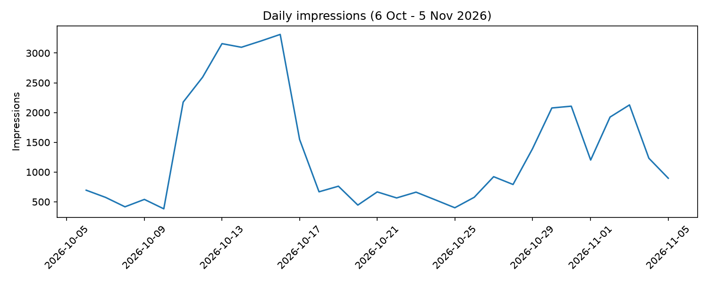
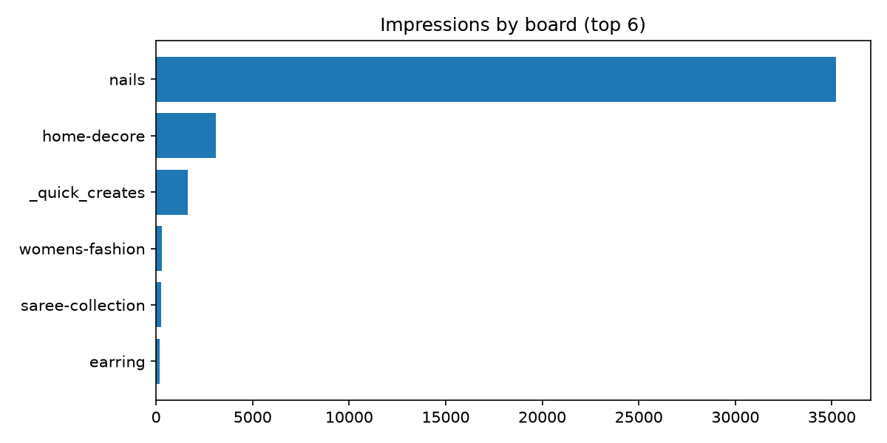
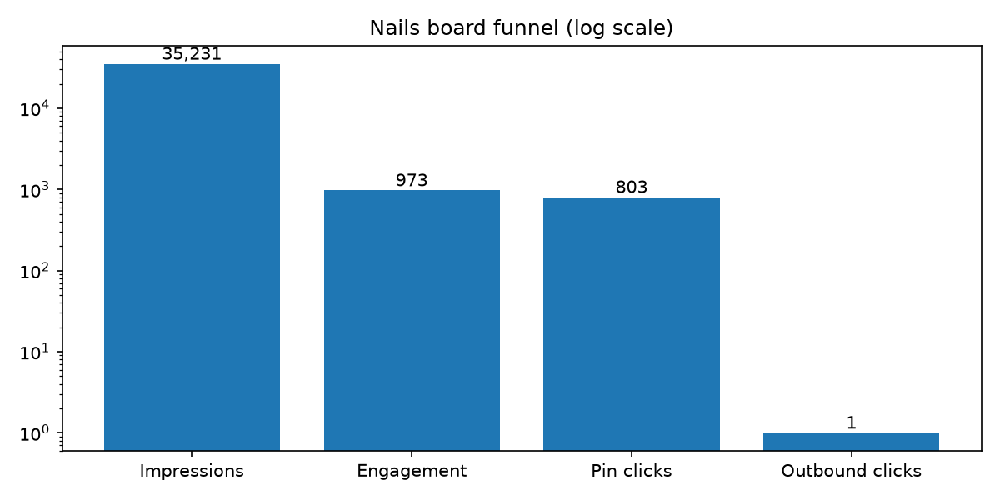

# Pinterest Analytics: Affiliate Account Performance

## Project overview
Analysis of 30 days of Pinterest Analytics data (6 Oct - 5 Nov 2026) from my nail-art affiliate account. The goal is to understand which content performs and why impressions are not turning into outbound clicks.

## Questions
1. How do daily impressions change over the 30 days, and what explains the spikes?
2. Is performance spread evenly across boards and pins, or does one dominate?
3. Which boards have the best engagement and save rates?
4. Where in the funnel (impressions, engagement, pin clicks, outbound clicks) do people drop off?
5. Why are outbound clicks so low, and what should change?

## Data
- Source: Pinterest Analytics export (overview, 6 Oct - 5 Nov 2026)
- File: `data/raw/` (contains daily impressions, top boards and top pins tables)
- Note: Pinterest marks the last two days as estimates

## Tools
Python, pandas, matplotlib, Jupyter Notebook (`notebooks/analysis.ipynb`)

## Method
1. The export holds three tables in one file, so I split it into daily, boards and pins data.
2. Calculated engagement rate, save rate and outbound click-through rate per board.
3. Measured how concentrated impressions are across pins and time.
4. Visualised the daily trend, board comparison and conversion funnel.

## Charts

## Key findings
- **One board drives the account:** the nails board has about 85% of all impressions (35,231 of 41,639).
- **Performance is concentrated:** the top pin has 44.6% of impressions and the top 5 pins have 64.2%.
- **Reach came in bursts:** 45.8% of impressions arrived in a single week (11-17 Oct).
- **The funnel breaks at the last step:** on the nails board, 35,231 impressions led to 973 engagements and 803 pin clicks, but only 1 outbound click (about 0.003% click-through).

## Recommendations
- Check that top pins have a working destination link set, and that the links go to the intended affiliate pages.
- Test pins with a clear call to action in the description and a visible product focus.
- Find what was posted around 11 Oct and 29 Oct and repeat that style and timing.
- Reduce dependence on a single pin by publishing more pins on the nails board consistently.

## Limitations
- Only 30 days of data from a small account, and one pin carries most of the results.
- The export has no pin titles and no saves or clicks per pin, so analysis is at board level.
- Outbound clicks are very few (2 in total), so click-through rates are not statistically reliable.
- The last two days are Pinterest estimates.